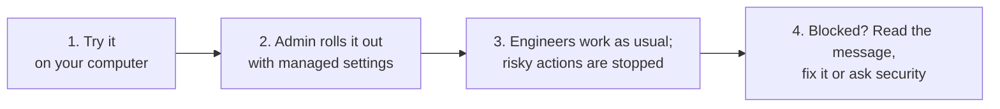

# Getting started, step by step

No security or Claude Code background needed. Pick the part that fits you:

| You are... | Go to |
|---|---|
| 👀 Curious: you want to see it work on your own computer first | [Part 1: Try it in a practice folder](#part-1-try-it-in-a-practice-folder) |
| 🛠️ The admin who rolls it out to the company | [Part 2: Roll it out to your organization](#part-2-roll-it-out-to-your-organization) |
| 👩‍💻 An engineer who works with Claude Code once it is installed | [Part 3: Working with it every day](#part-3-working-with-it-every-day) |
| 🚑 Someone whose action was blocked, or something looks broken | [Part 4: When something goes wrong](#part-4-when-something-goes-wrong) |



**In one sentence:** the plugin sits between Claude Code and your computer. Before the AI
agent runs a command, writes a file or pushes code, fixed rules decide: **allow**, **ask
you first**, or **deny**. A built-in CISO skill also reviews code and answers security
questions when you ask it.

---

## Part 1: Try it in a practice folder

Nothing is installed for the whole computer and no admin rights are needed. The plugin is
only active in the Claude Code window you start in step 3.

### ✅ Before you start

| You need | Check it with | Get it |
|---|---|---|
| Claude Code 2.1.316 or later | `claude --version` | https://docs.claude.com/en/docs/claude-code |
| uv (it runs the plugin's checks) | `uv --version` | https://docs.astral.sh/uv/getting-started/installation/ |
| git | `git --version` | https://git-scm.com/downloads |
| Internet access to PyPI on the first run | | uv downloads Python 3.13 and five small packages once |

### Step 1: Get the repository

Clone it, or download the ZIP and unpack it. Note where the folder is: you need the path
in step 3. Below it is called `<repo>`.

### Step 2: Make an empty practice folder

Never try this in a real project. PowerShell (Windows):

```powershell
mkdir $HOME\ciso-practice; cd $HOME\ciso-practice; git init
```

Terminal (macOS or Linux):

```bash
mkdir ~/ciso-practice && cd ~/ciso-practice && git init
```

### Step 3: Start Claude Code with the plugin

From inside the practice folder (replace `<repo>` with the real path):

```
claude --plugin-dir "<repo>/integrations/claude_code/ciso-plugin"
```

The first action takes longer while uv downloads its runtime once. After that each
checked action adds about half a second to a second.

### Step 4: Watch it allow something safe

Type to Claude:

> Run `git status`

It runs normally. Safe, read-only actions pass without bothering you.

### Step 5: Watch it stop something risky

Type to Claude:

> Create a file named `.mcp.json` containing `{}`

The file is **not** created. You get a message that starts with what was found and ends
with an id like `(CISO decision dec_...)`. Agent configuration files are protected,
because a changed `.mcp.json` can connect the agent to new tools.

### Step 6: Talk to the CISO

| Type this | What you get |
|---|---|
| `/ciso-agent:ciso review this repository` | A findings report: secrets, sensitive files, risky code, each with severity, `file:line` and how to fix it |
| `/ciso-agent:ciso check git push --force origin main` | The verdict for that command and the reason, before anyone runs it |
| `/ciso-agent:ciso audit-setup` | Risky settings in the agent setup: connector servers, instruction files, permissions, hooks |
| `/ciso-agent:ciso summary` | What was allowed and blocked so far, from the local log |
| `/ciso-agent:ciso can I paste customer data into a chatbot?` | The AI-use rules in plain words |

The skill **advises**. It never approves or unblocks anything; only the rules decide.

### Step 7: Clean up

Exit Claude Code and delete the practice folder. The plugin is gone with the session. Its
decision log stays in your Claude Code plugin data folder
(`~/.claude/plugins/data/`) and holds no prompts or file contents.

---

## Part 2: Roll it out to your organization

For the person who manages Claude Code for the company. Do every step on **one test
machine** first. Full detail: [the plugin README](../integrations/claude_code/ciso-plugin/README.md),
section "How an organization installs it".

| # | You do | You know it worked when |
|---|---|---|
| 1 | **Host the marketplace.** Copy the contents of `integrations/claude_code/` into its own private company git repository that every engineer can read. That folder must be the repository's root. | Engineers can clone it |
| 2 | **Remove what you do not deploy.** In `.claude-plugin/marketplace.json`, delete the `ai-governance` entry (it belongs to the unfinished server add-on). | Only `ciso-agent` is listed |
| 3 | **Fill in the template.** Edit `integrations/claude_code/managed-plugin/source.json`: the marketplace git URL (two places), your organization ID, and the admin-owned paths if yours differ. | No placeholders left |
| 4 | **Rebuild and check**, from the repository root: `uv run python tools/build_ciso_plugin.py`, then `uv run python integrations/claude_code/managed-plugin/check_managed.py integrations/claude_code/managed-plugin integrations/claude_code/ciso-plugin` | It prints `RESULT: READY`. Do not deploy anything else |
| 5 | **Prepare each machine** with your device management: install `uv` and git, and create the empty, admin-owned folder the template names for git hooks (Windows `C:\Program Files\CISOAgent\empty-hooks`, macOS `/Library/Application Support/CISOAgent/empty-hooks`, Linux `/usr/local/share/ciso-agent/empty-hooks`). git must be where `CISO_GIT_PATH` in the template points. | `uv --version` and git work for every user |
| 6 | **Deliver the managed settings** from `managed-plugin/<windows, macos or linux>/`: a file, the Windows registry or Group Policy, or a macOS profile. If you also set managed settings in the Claude admin console, copy the same keys there or set `managedSourcesBehavior` to `merge`. | On the machine, `/status` in Claude Code shows the managed source |
| 7 | **Test on one machine**, in a throwaway repository: `/plugin` lists `ciso-agent`; asking the agent to write `.mcp.json` is refused with a "CISO decision" id; `/ciso-agent:ciso summary` shows that decision. **Never test with a force push to a real branch:** if the hooks are not active, the push really happens. | All three behave as described |
| 8 | **Roll out** to everyone the same way. | Engineers see the CISO decisions |

**Optional, Claude apps (chat, Cowork):** build the skill alone with
`uv run python tools/build_ciso_plugin.py --zip dist/ciso-skill.zip`, and have an Owner
upload it under Organization settings > Plugins & skills. There it only gives advice;
nothing is enforced.

### 🛑 The emergency stop

To pause every AI-agent change in the company at once (reading stays allowed), set
`CISO_STOP` to `"1"` in the managed settings' `env` and redeploy. Machines re-read the
settings at start and every 30 minutes. Set it back to `"0"` to resume.

### ✏️ Changing the rules

The rules are readable JSON in `src/ciso/governance/rulesets/default.json`. After an edit:

1. `uv run python config/derive_governance_ruleset.py`
2. `uv run python tools/build_ciso_plugin.py`
3. `uv run pytest`, then push the marketplace repository again.

Skipping step 1 changes nothing the plugin enforces.

---

## Part 3: Working with it every day

Mostly you will not notice it. Every time the agent wants to act, one of three things
happens:

| You see | It means | You do |
|---|---|---|
| Nothing, the action just runs | **Allow**: the rules found it safe | Keep working |
| Claude Code asks you to confirm | **Ask**: allowed only if a person agrees | Read what it wants to do, then approve or decline |
| A message ending in `(CISO decision dec_...)` | **Deny**: the agent may not do this | Read the message: it says what was found and what to do instead |

**When you are denied:**

1. Read the message. It names the problem (for example a key in a file, or a protected
   file) without printing the secret itself.
2. Fix the cause (remove the secret, use a different file), or do the step yourself if it
   is a normal task the agent may not do, such as `git commit --amend`.
3. Still stuck? Send the security team the **decision id**. It lets them find the record.
4. Do not try to get around it. Every attempt is logged, and the rules exist for the
   whole company.

**Good to know:**

- **Pushes are scanned before they leave your computer.** A secret or a sensitive file in
  any commit stops the push.
- **Commits by the agent:** only the `git commit -m "message"` form can be checked. Other
  forms (`-a`, `--amend`, `-F`) are refused; make those commits yourself.
- **Too big to check:** binary changes, file writes over 256 KiB and diffs over 1 MB are
  refused. Do those by hand.
- **Unattended runs** (scripts, CI, `claude -p`): nobody can answer an "ask", so it counts
  as a refusal.
- **Your prompts and files are not logged.** The log keeps the decision, the rule and
  where something was found.

---

## Part 4: When something goes wrong

| What you see | Most likely cause | Fix |
|---|---|---|
| Every action is blocked, and the error mentions `uv` | uv is not installed or not on `PATH` | Install uv, then restart Claude Code |
| "the security check has no usable runtime" | uv cannot download Python 3.13 or the packages | Allow access to PyPI, or pre-fill the uv cache and set `UV_OFFLINE=1` in the managed `env` |
| Every `git push` is refused | git is not at the path in `CISO_GIT_PATH` | Install git there, or fix the path in the template |
| "the security team has paused all changes by AI agents" | The emergency stop is on | Wait for the security team, or (admins) set `CISO_STOP` to `"0"` |
| `/plugin` does not list `ciso-agent` | The managed settings did not reach this machine | Check `/status`, then the delivery (Part 2, step 6) |
| A commit is refused as "not inspectable" | A commit form other than `git commit -m` | Commit it yourself |
| An action is refused only in scripts or CI | It needed "ask", and nobody was there to answer | Run it interactively, or change the rules |
| Each action takes about a second | Normal: every action is checked first | Nothing to fix |

Still stuck? The [handover](HANDOVER-CISO-AGENT.md) lists every known limit, and the
[plugin README](../integrations/claude_code/ciso-plugin/README.md) has the full reference.

---

## Words used here

| Word | Meaning |
|---|---|
| **Plugin** | The installable package: the skill, the hooks and the rule engine together |
| **Skill** | The CISO you can talk to (`/ciso-agent:ciso`). It advises; it cannot block |
| **Hook** | A check that Claude Code runs before every action. This is what blocks |
| **Rules** | Fixed, tested rules in a JSON file. No AI model decides allow or deny |
| **Managed settings** | Settings IT pushes to every machine. Users cannot turn them off |
| **Marketplace** | The company git repository Claude Code installs the plugin from |
| **uv** | A small tool that runs the plugin's Python checks in an isolated environment |
| **Decision id** | The `dec_...` code on every decision, so a block can be looked up |
